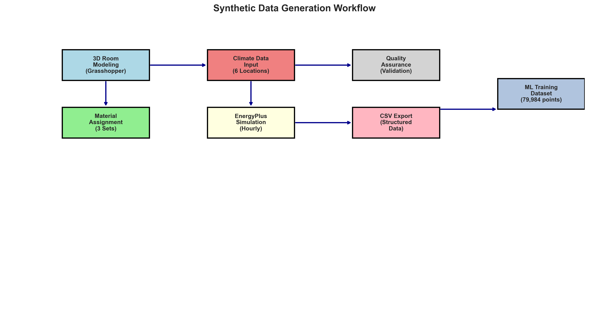
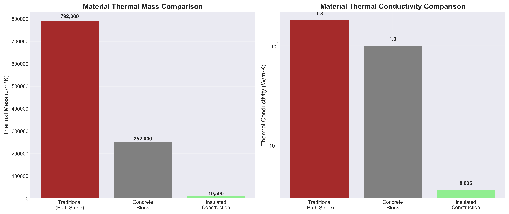
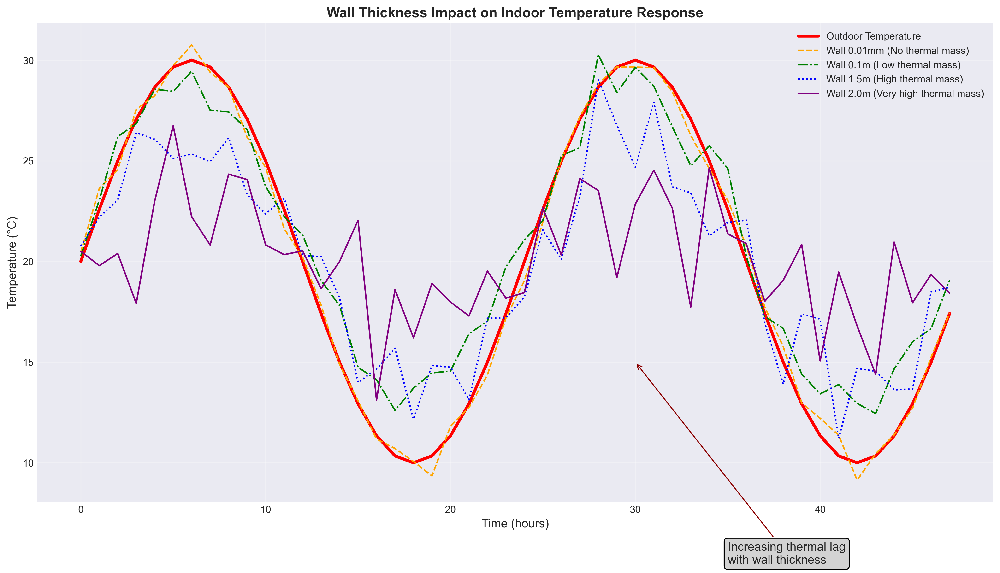
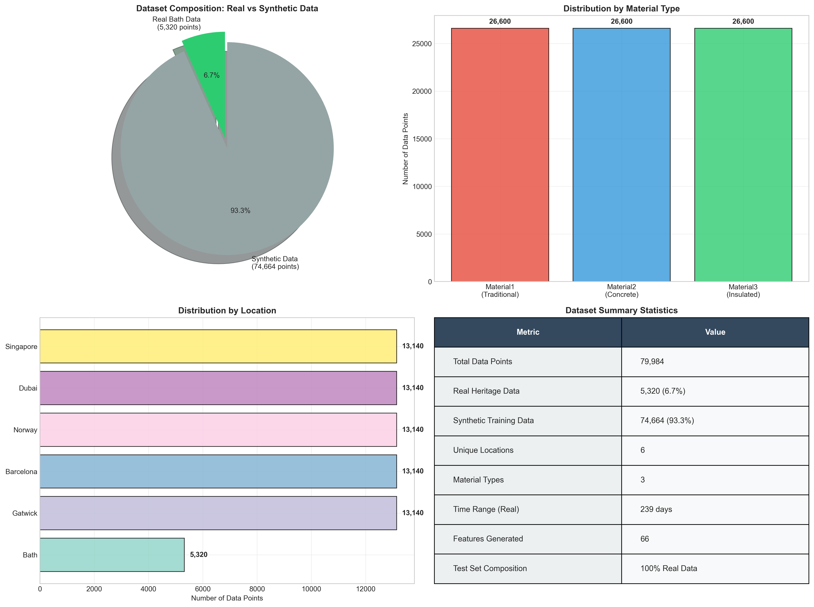
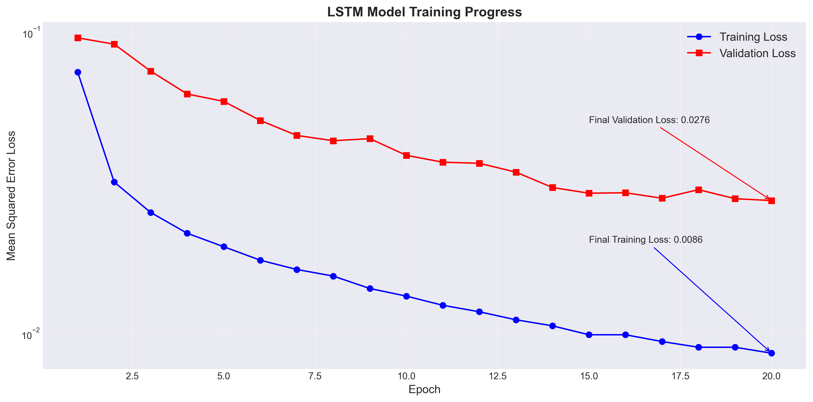
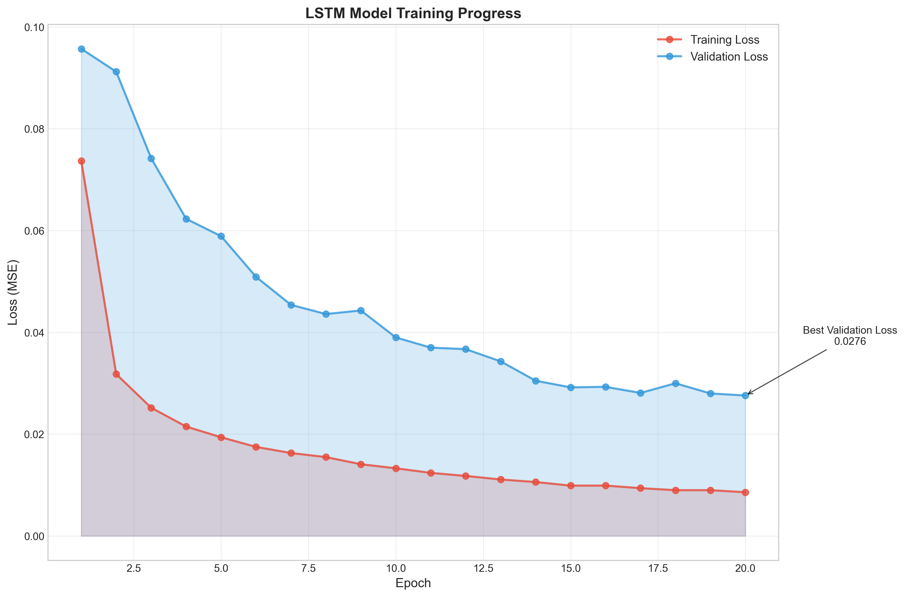
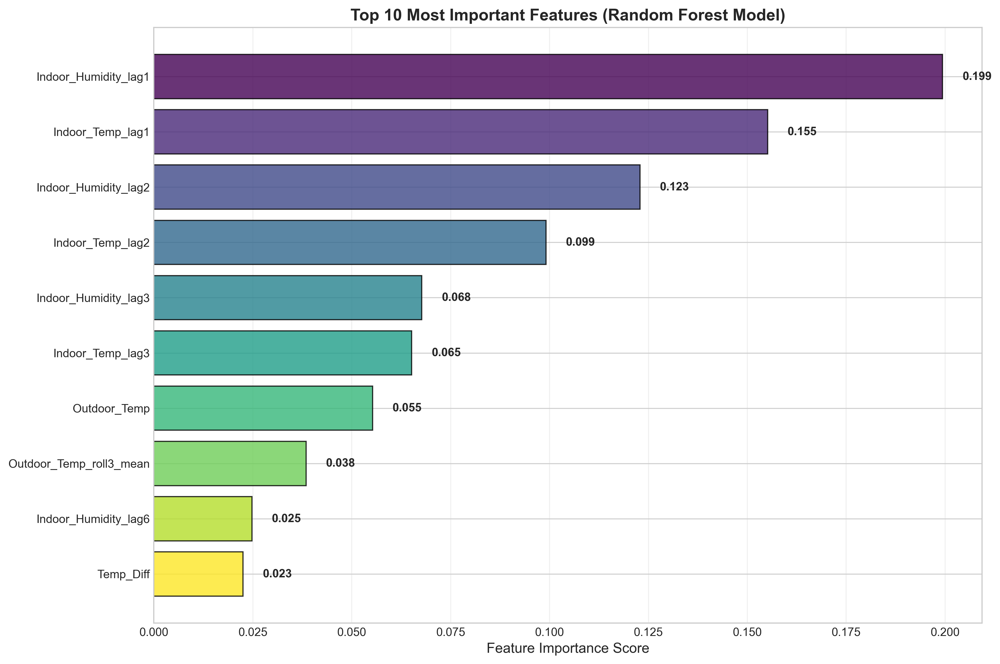
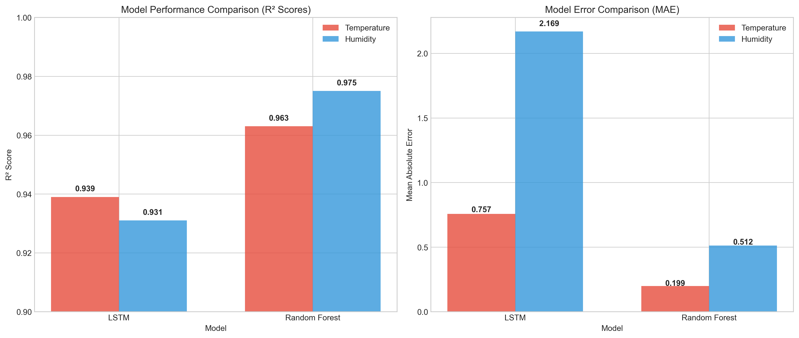

# heritage-indoor-climate-ml

# Machine Learning for Prediction of Indoor Temperature and Humidity in Heritage Buildings: A Hybrid Approach Combining Simulation, Model Comparison, and Conservation Practice

**MSc Artificial Intelligence in Engineering and Design | University of Bath | 2025**

**Author:** Riya Ramesh  
**Supervisor:** Dr Paul Shepherd

## Project Overview

This research investigates the application of machine learning for predicting indoor temperature and relative humidity in heritage buildings through a hybrid approach combining building energy simulation, synthetic data generation and real-world environmental measurements.

Heritage buildings present unique challenges for environmental management due to conservation restrictions that can limit intrusive monitoring systems and modern building services. Fluctuations in indoor temperature and humidity can affect occupant comfort and contribute to the deterioration of historic building materials, including limestone, plaster and timber.

The research explores whether machine learning models can provide accurate predictions of indoor environmental conditions to support evidence-based conservation decisions.

Two machine learning approaches, **Random Forest (RF)** and **Long Short-Term Memory (LSTM)**, were developed, evaluated and compared. The best-performing Random Forest model was subsequently integrated into Grasshopper to demonstrate practical applications in architectural and heritage conservation workflows.

## Research Objectives

1. Generate synthetic environmental datasets using Rhinoceros 3D, Grasshopper, Ladybug, Honeybee and EnergyPlus, representing different climatic conditions and construction material configurations.
2. Develop and compare Random Forest and LSTM models for simultaneous prediction of indoor temperature and relative humidity.
3. Validate model performance using real-world environmental measurements from a Grade I listed Georgian residential building in Bath.
4. Integrate the best-performing model into Grasshopper to demonstrate an interactive prediction tool for heritage-building environmental management.

## Methodology



### 1. Synthetic Data Generation

Parametric building energy simulations were developed in Rhinoceros 3D and Grasshopper using Ladybug and Honeybee plugins, with EnergyPlus and OpenStudio for environmental simulations.

A standardised room geometry representing Georgian room proportions was developed in Rhino. Honeybee components were used to assign construction materials, thermal properties, glazing configurations and weather data.

Six locations were considered to represent different climatic conditions:

| Location | Climate |
|---|---|
| Bath, United Kingdom | Temperate |
| Gatwick, United Kingdom | Temperate |
| Barcelona, Spain | Mediterranean |
| Norway | Cold Nordic |
| Dubai, UAE | Hot and arid |
| Singapore | Tropical |

### 2. Construction Material Configurations

Three material sets were developed to investigate the influence of construction methods and thermal properties on indoor environmental conditions.

#### Material Set 1: Traditional Heritage Construction

Represents historic Georgian construction, particularly the traditional building fabric found in Bath.

| Building component | Material | Thickness |
|---|---|---|
| External walls | Bath limestone | 0.36 m |
| Wall finish | Plaster | 0.02 m |
| Roof | Slate | 0.02 m |
| Floor | Concrete | 0.15 m |

The primary wall construction uses Bath stone with a thermal conductivity of 1.8 W/mK and density of 2,200 kg/m³. Its high thermal mass contributes to delayed thermal responses and relatively stable indoor temperatures.

#### Material Set 2: Modern Concrete Construction

Represents construction with moderate thermal mass using concrete blocks and reinforced concrete assemblies.

| Building component | Material | Thickness |
|---|---|---|
| External walls | Hollow concrete blocks with plaster | 0.20 m |
| Roof | Reinforced concrete slab | 0.15 m |
| Floor | Concrete slab on grade | 0.15 m |

This configuration represents construction methods between traditional heavyweight materials and contemporary insulated systems.

#### Material Set 3: High-Performance Insulated Construction

Represents contemporary construction systems designed to improve thermal insulation.

| Building component | Material | Thickness |
|---|---|---|
| External walls | Insulated plasterboard with EPS insulation | 0.25 m |
| Roof | Composite metal and insulation panels | 0.20 m |
| Floor | Timber with insulation | 0.15 m |

This material set has lower thermal mass and higher thermal resistance, producing a different environmental response compared with traditional stone construction.



### 3. Simulation Dataset

Each material configuration was evaluated across selected climatic locations.

The simulation methodology considered **17 climate-material combinations**, excluding Bath with Material Set 1, which was represented by the real-world heritage-building dataset.

The final synthetic dataset contained **74,664 hourly data points**.

The climate-specific CSV files are stored in `Data/`.

**Dataset naming convention**

| File naming | Construction type |
|---|---|
| `Barcelona.csv` | Material Set 1: Traditional heritage |
| `Barcelona02.csv` | Material Set 2: Concrete |
| `Barcelona03.csv` | Material Set 3: Insulated |
| `Bath02.csv` | Material Set 2: Concrete |
| `Bath03.csv` | Material Set 3: Insulated |

The same convention applies to the other climate datasets.

The original Bath monitoring dataset representing the heritage construction case is not publicly included.

### 4. Thermal Validation and Wall-Thickness Experiments

Before using the simulated environmental datasets for machine learning, wall-thickness sensitivity experiments were conducted to evaluate whether the simulations represented expected building thermal behaviour.

Different wall thicknesses were tested, including:

- 0.01 mm: Minimal thermal mass and rapid response to outdoor conditions.
- 0.1 m: Moderate thermal lag.
- 1.5 m: Significant thermal inertia and delayed temperature response.
- 2.0 m: Maximum tested thermal lag due to high thermal mass.



The experimental CSV files, including `001MMCheck`, `01check`, `2mcheck` and `15check`, are retained in `Data/`.

These tests helped validate the sensitivity of the simulation workflow to material thickness and thermal mass.

### 5. Real-World Environmental Measurements

Real environmental monitoring data was obtained from a Grade I listed Georgian residential building in Bath, United Kingdom.

The dataset covered approximately 239 days between November 2023 and July 2024.

Original room-level measurements were aggregated into hourly, apartment-level averages to represent broader building environmental conditions and align with the simulated datasets.

The final measured dataset consisted of **5,320 hourly observations**.

The most recent 20% of the real dataset, comprising 1,064 observations, was reserved for model evaluation.

### 6. Data Preparation and Feature Engineering

Python scripts in `Data Preparation/` were used to clean, standardise and export the simulation datasets into CSV format.

The standardised dataset structure contained five primary columns:

- `Datetime`
- `Outdoor_Temp`
- `Indoor_Temp`
- `Outdoor_Humidity`
- `Indoor_Humidity`

Advanced feature engineering produced **66 engineered features**, including:

- Lagged indoor and outdoor environmental values.
- Rolling means and standard deviations.
- Cyclical time encodings using sine and cosine transformations.
- Material thermal properties, including conductivity, density and specific heat.
- Thermal mass and environmental interaction features.

These features provided temporal and physical context for machine learning predictions.

### 7. Machine Learning Models

#### Random Forest

A multi-output Random Forest regression model was developed using scikit-learn to simultaneously predict indoor temperature and relative humidity.

The model incorporated engineered features, material characteristics and temporal validation.

A hybrid training strategy combined synthetic simulation data with historical measurements from the Bath heritage building, while the final testing stage used chronologically held-out real observations.

#### Long Short-Term Memory (LSTM)

An LSTM neural network was developed using TensorFlow/Keras to model temporal dependencies in indoor environmental conditions.

| Parameter | Configuration |
|---|---|
| Sequence length | 48 hours |
| LSTM units | 64 |
| Dropout | 0.2 |
| Epochs | 20 |
| Batch size | 32 |
| Optimiser | Adam |
| Loss function | Mean Squared Error |

Both models were assessed using time-aware validation strategies to minimise future-data leakage.

## Model Results and Comparison

The final models were evaluated using real-world measurements from the Bath heritage building.

| Metric | Random Forest | LSTM |
|---|---:|---:|
| Temperature MAE (°C) | **0.199** | 0.757 |
| Temperature RMSE (°C) | **0.253** | 1.055 |
| Temperature R² | **0.963** | 0.939 |
| Relative Humidity MAE (% RH) | **0.512** | 2.169 |
| Relative Humidity RMSE (% RH) | **0.720** | 3.555 |
| Relative Humidity R² | **0.975** | 0.931 |








### Key Findings

- Random Forest outperformed LSTM across all reported evaluation metrics.
- Random Forest achieved R² values of 0.963 for indoor temperature and 0.975 for relative humidity.
- Temperature prediction errors averaged approximately 0.2°C.
- Relative humidity prediction errors averaged approximately 0.5 percentage points.
- Historical indoor environmental conditions were among the most influential predictive features.
- Material characteristics provided physical context for the different construction configurations.



These findings demonstrate the potential of machine learning to support environmental prediction and conservation-sensitive decision-making in historic buildings.



## Grasshopper Integration

Following model comparison, the best-performing Random Forest model was exported as a `.pkl` file and integrated into Grasshopper using a GHPython component.

The tool allows users to provide outdoor environmental conditions, time information and construction material parameters to obtain predicted indoor conditions.

**Inputs:** Outdoor temperature, outdoor relative humidity, hour, month and material set.

**Outputs:** Predicted indoor temperature and predicted indoor relative humidity.

The dissertation reports Grasshopper validation deviations within approximately ±3°C for temperature and 3-5 percentage points for relative humidity for the checked hourly readings.

This demonstrated the feasibility of embedding a trained machine learning model within an architectural parametric design environment.

## Repository Structure

```text
heritage-indoor-climate-ml/
│
├── Archive Notebooks/
│   ├── 01_RF.ipynb
│   ├── 02_RF.ipynb
│   ├── 03_RF.ipynb
│   ├── 04_RF.ipynb
│   ├── 05_RF.ipynb
│   ├── 06_RF.ipynb
│   ├── 01_LSTM.ipynb
│   ├── 02_LSTM.ipynb
│   └── 03_LSTM.ipynb
│
├── Data/
│   ├── Synthetic climate/material CSV datasets
│   └── Wall-thickness validation CSV datasets
│
├── Data Preparation/
│   ├── Climate-specific data preparation scripts
│   ├── Testing.py
│   └── Validation.py
│
├── Figures/
│   ├── data_distribution
│   ├── dataset_composition_analysis
│   ├── feature_importance_analysis
│   ├── lstm_training
│   ├── lstm_training_progress
│   ├── material_comparison
│   ├── model_performance_comparison
│   ├── monthly_performance_analysis
│   ├── thermal_validation
│   └── workflow_diagram
│
├── Final Notebooks/
│   ├── Final_LSTM.ipynb
│   ├── Final_Random_Forest.ipynb
│   ├── Visual.ipynb
│   └── visual2.ipynb
│
├── .gitignore
├── LICENSE
└── README.md
```

*Figure filenames are displayed without extensions in this overview. The original image files are stored in `Figures/`.*

### Folder Descriptions

**`Archive Notebooks/`**

Contains earlier Random Forest and LSTM experiments, including intermediate model iterations, feature engineering experiments and validation attempts.

These notebooks are retained to document the research development process and should not be interpreted as the final model implementation.

**`Data/`**

Contains the synthetic CSV datasets generated from the building energy simulations.

Also includes experimental wall-thickness validation datasets used to evaluate thermal responses under different material thicknesses.

The original private Bath monitoring dataset is excluded.

**`Data Preparation/`**

Contains Python scripts used to process, clean, format and export the simulation datasets.

The scripts are organised by climatic location and construction material configuration, with additional testing and validation scripts.

**`Figures/`**

Contains visual outputs from the research, including dataset distribution, material comparisons, feature importance, training progress, thermal validation, monthly performance and Random Forest versus LSTM comparisons.

**`Final Notebooks/`**

Contains the final machine learning implementation and analysis notebooks:

- `Final_Random_Forest.ipynb`: Final Random Forest modelling workflow.
- `Final_LSTM.ipynb`: Final LSTM modelling workflow.
- `Visual.ipynb` and `visual2.ipynb`: Research visualisation and analysis notebooks.

## Research Development Process

The modelling process involved iterative experiments with data preparation, feature selection, model architectures and validation strategies.

Early Random Forest experiments demonstrated strong validation performance but encountered difficulties during independent test evaluation.

Subsequent iterations focused on chronological data splitting, improvements to feature engineering, and more reliable evaluation against future observations.

The archived notebooks preserve these experiments to provide transparency into the research process, including unsuccessful attempts and improvements made before the final models were selected.

## Data Availability and Privacy

The synthetic datasets generated through building energy simulations are included in this repository.

The real-world Bath monitoring dataset is not publicly available in the repository because it was obtained from a privately occupied heritage residential building and may be subject to privacy and data-sharing restrictions.

As a result, reproducing the reported real-world evaluation metrics requires authorised access to the original monitoring data.

## Running the Code

The project was developed using Python and Jupyter Notebook.

Primary Python libraries include:

- pandas
- numpy
- scikit-learn
- TensorFlow / Keras
- matplotlib
- joblib

To explore the project:

1. Clone or download the repository.
2. Create a Python environment and install the relevant libraries.
3. Review the data preparation scripts in `Data Preparation/`.
4. Open the final modelling notebooks in `Final Notebooks/`.
5. Update any local file paths and input references where necessary.
6. Review the results and visualisations in `Figures/`.

Some modelling procedures require the original Bath dataset or saved trained models that are not publicly included. Consequently, the repository documents the full research workflow but does not currently guarantee end-to-end reproduction of the published results.

## Research Limitations

- Real-world validation was limited to a single Grade I listed Georgian residential building.
- The measured dataset covered 239 days rather than a complete year.
- Simulation assumptions may not fully represent real occupant behaviour and ventilation conditions.
- The model does not explicitly account for all moisture-buffering processes in traditional building materials.
- Further testing across different building typologies and climatic conditions is required to establish broader model generalisability.

## Future Research

Future work could explore:

- Validation using additional heritage-building datasets.
- Improved modelling of humidity buffering and moisture transport.
- Integration of occupancy and ventilation parameters.
- Further development of the Grasshopper prediction interface.
- Predictive environmental risk monitoring for heritage conservation.
- Applications in adaptive reuse, retrofit assessment and sustainable building management.

## Technologies Used

**Machine Learning:** Python, scikit-learn, TensorFlow/Keras, pandas, NumPy, Jupyter Notebook

**Building Simulation:** Rhinoceros 3D, Grasshopper, Ladybug, Honeybee, EnergyPlus, OpenStudio

**Development and Visualisation:** Visual Studio Code, Git, GitHub, matplotlib

## Academic Information

**Dissertation:** *Machine Learning for Prediction of Indoor Temperature and Humidity in Heritage Buildings: A Hybrid Approach Combining Simulation, Model Comparison, and Conservation Practice*

**Author:** Riya Ramesh  
**Degree:** MSc Artificial Intelligence in Engineering and Design  
**University:** University of Bath, United Kingdom  
**Department:** Electronic and Electrical Engineering  
**Supervisor:** Dr Paul Shepherd  
**Year:** 2025

## Citation

Ramesh, R. (2025). *Machine Learning for Prediction of Indoor Temperature and Humidity in Heritage Buildings: A Hybrid Approach Combining Simulation, Model Comparison, and Conservation Practice*. MSc Dissertation, University of Bath.

## License and Copyright

See the repository's `LICENSE` file for the applicable licence terms.

The dissertation text remains copyright © 2025 Riya Ramesh. The private Bath monitoring dataset is not publicly distributed.
